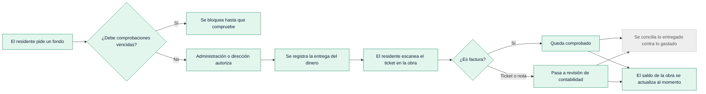

# Cierre de iteración y presentación al cliente

> **Iteración que se cierra:** Iteration 6 (16 de noviembre al 2 de diciembre de 2026)
> **Versión que se presenta:** v0.3.0, instalada desde el paquete de la release antes de empezar
> **Presentación:** 12 minutos como máximo
>
> Este documento reúne el cierre del proyecto que pide la práctica: lo terminado y lo pendiente, el guion de la presentación, las historias que se demuestran, las preguntas preparadas y la retrospectiva. Cada integrante completa su parte mediante un pull request propio.

## 1. Planeado contra terminado

**Objetivo de Iteration 6:** reunir en una sola pantalla el trabajo del administrador (autorizaciones con sus bloqueos, entregas, saldos y alertas), mostrar a cada rol solo sus apartados y entregar un escaneo de comprobantes que se inicia desde un botón fijo y confirma en 20 segundos o menos.

| | Planeado | Terminado | Pasa a Iteration 7 |
| :--- | ---: | ---: | ---: |
| Tarjetas | 15 | 10 (67 %) | 5 |
| Horas estimadas (todas las tarjetas) | 201 h | 117 h (58 %) | 84 h |
| Requerimientos RF/RNF (sin contar los CC) | 6 · 50 h | 4 · 28 h (56 %) | 2 · 22 h |

Las tarjetas de cambio del cliente (CC-01 40 h, CC-02 13 h y CC-03 48 h) agrupan las horas de sus requerimientos, así que la fila de requerimientos es la que mide mejor el avance real. El mismo comparativo está publicado como status update de cierre en el tablero del proyecto.

## 2. Lo terminado

### En Iteration 6

| Requerimiento | Historia | Cambio del cliente | Qué puede hacer el usuario | Responsable | Pull request |
| :--- | :--- | :--- | :--- | :--- | :--- |
| RNF05 - Escaneo rápido de comprobantes (#68) | HU21 (#69) | CC-03 | El residente escanea un ticket desde un botón siempre visible, solo confirma con un toque y el sistema le pide repetir la foto si salió borrosa u oscura. | @PauAlba | #90 |
| RF08 - Validación de comprobante (#23) | HU08 (#24) | CC-03 | Un gasto sin foto no se puede cerrar; la factura queda comprobada y el ticket o la nota simple pasa a revisión de contabilidad, sin pasos extra. | @PauAlba | #102 |
| RF04 - Bloqueo por comprobaciones vencidas (#15) | HU04 (#16) | CC-01 | El residente con comprobaciones vencidas no recibe fondos nuevos y administración lo ve marcado en la bandeja de autorización, con los folios pendientes. | @juanpismata11 | #101 |
| RF06 - Registro de entrega del recurso (#19) | HU06 (#20) | CC-01 | Administración registra, desde la bandeja de autorización, si entregó el dinero en efectivo, tarjeta o transferencia, con su referencia, la fecha y quién lo entregó. La solicitud aprobada aparece lista para registrar su entrega sin recargar la página. | @jaaaaaaaaasiel | #106 |

También se cerraron el análisis de CC-02 (#73) y de CC-03 (#74), y quedaron integradas las revisiones de calidad y seguridad de la investigación #86 (#87, #88, #89, #98, #99).

### En todo el proyecto (hasta v0.3.0)

| Requerimiento | Historias | Iteración |
| :--- | :--- | :--- |
| RF01 - Registro de solicitud de fondo | HU01 | Iteration 3 |
| RF02 - Clasificación obligatoria por obra, etapa y partida | HU02 | Iteration 3 |
| RF03 - Niveles de autorización por monto | HU03 | Iteration 3 |
| RF05 - Aprobación o rechazo de solicitudes | HU05 | Iteration 4 |
| RF07 - Captura de comprobación del gasto | HU07 | Iteration 4 |
| RF10 - Saldos por obra en tiempo real | HU10 | Iteration 4 |
| RNF01 - Captura con mínimos toques | HU16 | Iteration 4 |
| RF04 - Bloqueo por comprobaciones vencidas | HU04 | Iteration 6 |
| RF06 - Registro de entrega del recurso | HU06 | Iteration 6 |
| RF08 - Validación de comprobante | HU08 | Iteration 6 |
| RNF05 - Escaneo rápido de comprobantes | HU21 | Iteration 6 |

## 3. Lo pendiente

### Pasa de Iteration 6 a Iteration 7

Cada tarjeta quedó en Backlog de Iteration 7 con un comentario que explica por qué no se terminó. Si alguna se integra con un pull request aprobado antes del 2 de diciembre, regresa a Iteration 6 en Done, como pasó con RF06.

| Requerimiento | Historia | Cambio | Por qué no se terminó | Qué se necesita del cliente | Entra en |
| :--- | :--- | :--- | :--- | :--- | :--- |
| RNF04 - Pantalla única por rol (#64) | HU19 (#65) | CC-01 (#72) | Es el cambio más grande (40 h en total) y al cierre no había un pull request integrado. Depende de los apartados por rol. | Confirmar el orden de prioridad de los apartados del administrador: autorizaciones, entregas, conciliación, saldos y alertas. | Iteration 7 |
| RF15 - Apartados visibles según el rol (#66) | HU20 (#67) | CC-02 | El trabajo existe en la rama `feat/15-apartados-segun-rol-y-docker`, pero al cierre no tenía pull request ni aprobación, así que no cumple la definición de terminado. | Validar la matriz de apartados por rol de `docs/CONTEXT.md` y la lista de personas con su rol. | Iteration 7 |

### Ya planeado para Iteration 7 (3 al 13 de diciembre)

| Requerimiento | Historia | Cambio | Estado al cierre de Iteration 6 |
| :--- | :--- | :--- | :--- |
| RF09 - Conciliación de sobrantes y faltantes (#25) | HU09 (#26) | CC-01 | En progreso |
| RF11 - Extracción automática de datos (OCR) (#29) | HU11 (#30) | CC-03 | Integrado con el PR #100; falta su criterio de captura sin señal, que depende de RNF02 |
| RNF02 - Captura offline y sincronización (#40) | HU17 (#41) | CC-03 | Sin iniciar |

**Carga de Iteration 7:** 5 requerimientos y 66 h, de las que unas 50 h siguen por hacer porque RF11 ya está integrado. Orden propuesto: apartados por rol, pantalla única, conciliación dentro de esa pantalla y, al final, la captura sin señal. Si no alcanza la capacidad, RNF02 es lo primero que se propone posponer, siempre con el acuerdo del cliente.

### Pospuestos (Backlog sin iteración, etiqueta `POSPUESTO`)

RF12 (HU12, HU13), RF13 (HU14), RF14 (HU15) y RNF03 (HU18). No forman parte de los cambios que pidió el cliente y no caben antes de la entrega final.

## 4. Guion de la presentación

**Reglas que sigue el guion:** la versión v0.3.0 está instalada antes de empezar y con datos de ejemplo cargados; se habla de lo que el usuario puede hacer, no de tecnología; no se muestran código, terminal ni tablero. No hay diapositivas: todo se presenta con la aplicación funcionando. Al minuto 12 se detiene la presentación.

**Cuida el tiempo:** @casizzy (avisa con la mano al minuto 6, al minuto 8 y al minuto 11).

| Minuto | Bloque | Responsable | Qué se muestra |
| :--- | :--- | :--- | :--- |
| 0:00 a 1:00 | Apertura: el proyecto en general y su diagrama de flujo | @bladeRunner08 | Diagrama de flujo de la aplicación |
| 1:00 a 2:15 | Demostración: bloqueo por comprobaciones vencidas (HU04, CC-01) | @juanpismata11 | Aplicación |
| 2:15 a 3:15 | Demostración: registro de la entrega del dinero (HU06, CC-01) | @jaaaaaaaaasiel | Aplicación |
| 3:15 a 5:00 | Demostración: escaneo rápido de comprobantes (HU21, CC-03) | @PauAlba | Aplicación en el celular |
| 5:00 a 6:30 | Demostración: comprobante válido y cierre automático (HU08, CC-03) | @PauAlba | Aplicación |
| 6:30 a 7:00 | Demostración: el saldo de la obra refleja el comprobante (HU10) | @jaaaaaaaaasiel | Aplicación |
| 7:00 a 7:30 | Pendientes: pantalla única (CC-01) | @jaaaaaaaaasiel | Se explica de palabra |
| 7:30 a 8:00 | Pendientes: apartados por rol (CC-02) | @casizzy | Se explica de palabra |
| 8:00 a 12:00 | Preguntas del cliente | Todos; modera @bladeRunner08 | Aplicación, si hace falta mostrar algo |

El orden de la demostración sigue el uso real: el residente pide dinero, administración registra cómo se lo entregó, el residente comprueba su gasto escaneando el ticket, el comprobante se valida y la dirección ve el saldo de la obra al momento. Empieza por los cambios que pidió el cliente.

### 0:00 a 1:00 · Apertura (@bladeRunner08)

Es una introducción breve al proyecto en general. El diagrama de flujo sirve de mapa: explica cómo se mueve el dinero de caja chica dentro de la aplicación, y cada demostración que sigue es un paso de ese mapa.

> Buenos días. Somos Stella, Juan Pablo, Jaasiel, Paulina y Mariano, y desarrollamos el módulo de Administración de Gastos y Caja Chica para sus obras.
>
> La idea del proyecto es que el dinero que sale para la obra quede siempre comprobado: que no se pierdan tickets y que dirección sepa en todo momento cuánto se lleva gastado en cada obra, sin esperar a fin de mes.
>
> *(Muestra el diagrama de flujo)* Para explicar cómo funciona la aplicación usamos este diagrama de flujo. El residente pide un fondo, administración o dirección lo autoriza, se le entrega el dinero, el residente escanea el ticket en la obra, el sistema revisa que el comprobante sea válido y el saldo de la obra se actualiza al momento.
>
> En verde está lo que ya funciona y en gris lo que les vamos a proponer para la siguiente iteración. Esta vez nos enfocamos en los cambios que nos pidieron, sobre todo en un escaneo más rápido.
>
> Vamos a recorrer el flujo en ese orden. Empieza Juan Pablo con la solicitud del fondo.

**Diagrama de flujo simplificado.** Se muestra como imagen en la misma computadora de la demostración, antes de abrir la aplicación. Es una versión corta de `docs/DIAGRAMA_FLUJO.md` en el lenguaje del cliente, sin identificadores de requerimientos. Verde: terminado y se demuestra. Gris: propuesta para Iteration 7.

La pantalla única del administrador y los apartados por rol no son un paso del flujo: cambian dónde y quién ve cada paso. Se explican como propuesta en el bloque de pendientes.

### 1:00 a 2:15 · Bloqueo por comprobaciones vencidas (@juanpismata11)

_Lo escribe @juanpismata11 mediante pull request: qué dice, qué muestra en pantalla y con qué datos de ejemplo._

### 2:15 a 3:15 · Registro de la entrega del dinero (@jaaaaaaaaasiel)

- **Qué dices:** "Una vez aprobada la solicitud, administración registra desde la bandeja de autorización cómo se entregó el recurso —efectivo, tarjeta o transferencia—, junto con la referencia, la fecha y quién realizó la entrega. Aquí tomamos la solicitud aprobada para la obra Remodelación segundo piso de Liverpool Plaza Mayor, a cargo de Jorge Luis Osorio, por $3,500; al guardar el registro, queda asentado quién dispersó el dinero y la solicitud aparece lista para registrar entrega sin necesidad de recargar la página."
- **Qué haces en pantalla:**
  1. Abrir la bandeja de autorización y ubicar la solicitud aprobada de **Jorge Luis Osorio** en **Remodelación segundo piso de Liverpool Plaza Mayor** por **$3,500**.
  2. Registrar la entrega indicando método (efectivo, tarjeta o transferencia), referencia, fecha y responsable desde el apartado correspondiente.
  3. Mostrar que el registro guarda a la persona que dispersó el recurso y que la solicitud aparece lista sin recargar la página.
- **Criterio de aceptación que cumple:** se cubre añadir referencia bancaria o marcar efectivo en una solicitud autorizada, consultar el nombre de quien dispersó el recurso al revisar la solicitud y ver la solicitud lista para registrar entrega sin cambiar de pantalla ni recargar.

### 3:15 a 6:30 · Escaneo rápido y comprobante válido (@PauAlba)

**Datos de ejemplo:** residente `RESIDENTE-PAU` (Paulina), obra **Torre Residencial Cimas Norte** y su solicitud aprobada **"Tubería y conexiones de PVC para la línea hidráulica"** por **$2,400**. Se escanean un ticket y una factura reales de una ferretería, elegidos y probados con la instalación de la v0.3.0 antes de presentar. La demostración se hace en el celular, con la pantalla proyectada o espejada.

#### 3:15 a 5:00 · Escaneo rápido (HU21)

- **Qué dices:** "El residente está en la obra, con prisa y con las manos ocupadas. Por eso, al abrir la aplicación en el celular solo ve lo necesario: la solicitud aprobada y un botón grande, **Escanear comprobante**, que siempre está a la vista. Aquí Paulina, residente de la obra Torre Residencial Cimas Norte, tiene aprobada la solicitud de tubería por $2,400. La aplicación ya sabe a qué solicitud y a qué obra pertenece el comprobante, así que no hay que escribir nada. Toco el botón, tomo la foto del ticket y confirmo con un toque. Puedo seguir trabajando: el comprobante se envía en segundo plano y en pantalla aparece cuántos segundos pasaron desde que toqué Escanear. La meta que acordamos es de 20 segundos o menos. Y si la foto sale mal, la aplicación no la deja pasar: aquí la tomé a oscuras y me pide repetirla con más luz, antes de guardarla."
- **Qué haces en pantalla:**
  1. En el celular, abrir la aplicación como `RESIDENTE-PAU`, elegir la solicitud de tubería y señalar el botón fijo **Escanear comprobante**.
  2. Señalar la línea que dice a qué solicitud y obra se vincula el comprobante.
  3. Tocar **Escanear comprobante**, fotografiar el ticket y confirmar la foto.
  4. Mostrar el aviso de que se envió en segundo plano y el tiempo que tardó, escrito en pantalla.
  5. Tomar una foto tapando la cámara y mostrar que pide repetirla; tocar **Repetir foto**.
- **Criterio de aceptación que cumple:** el botón "Escanear comprobante" está fijo y visible sin desplazarse; con la foto, la obra y la solicitud activa ya vienen vinculadas y solo se confirma con un toque; la confirmación aparece sin esperar a que termine la subida; y una foto borrosa u oscura se rechaza antes de guardarla.

> Nota para el ensayo: el tiempo real se lee en la pantalla del celular. La meta de 20 segundos o menos todavía debe medirse en el celular de la demostración y dejar la evidencia en la tarjeta #68. Si no se cumple, el escaneo rápido se presenta como propuesta y no como terminado.

#### 5:00 a 6:30 · Comprobante válido y cierre automático (HU08)

- **Qué dices:** "Un gasto solo cuenta si tiene su comprobante. La aplicación no permite cerrar un gasto sin foto, y lo que ven aquí pasa solo, sin pasos extra. Abro el ticket que acabo de escanear: la aplicación leyó el proveedor, la fecha y el monto, y como los cuatro datos se leyeron completos, el comprobante se cerró solo. Como es un ticket y no una factura, pasa automáticamente a revisión de contabilidad, porque hay proveedores que no dan factura. Ahora escaneo una factura: queda como comprobada, sin revisión adicional. Si la foto no se hubiera leído completa, no se cierra sola: queda por completar y el residente la confirma. Con esto, contabilidad solo revisa lo que de verdad lo necesita."
- **Qué haces en pantalla:**
  1. Abrir **Ver foto y datos** del ticket escaneado y mostrar lo que se leyó (proveedor, fecha, monto, tipo) y el estado **Revisión contabilidad**.
  2. Escanear la factura con el mismo botón y mostrar el aviso **Comprobante enviado y comprobado**.
  3. Abrir **Ver foto y datos** de la factura y mostrar su estado **Comprobado**.
  4. Decir, sin mostrarlo, que un gasto sin foto no se puede cerrar y que una lectura incompleta queda por completar.
- **Criterio de aceptación que cumple:** un gasto sin comprobante no se puede cerrar como comprobado; un ticket o una nota simple pasa solo a revisión de contabilidad; y un gasto con factura queda comprobado sin revisión adicional ni pasos extra.

> Nota: la lectura automática de los datos (HU11) es la que permite el cierre automático, pero todavía le falta el criterio de captura sin señal (entra en Iteration 7). Se muestra como parte de este bloque y no se presenta como historia terminada.

### 6:30 a 7:30 · Saldo de la obra y pendientes de la pantalla única (@jaaaaaaaaasiel)

- **Qué dices (6:30 a 7:00 · HU10):** "Ahora veamos cómo impacta en el saldo de la obra el comprobante que acaba de subir Paulina. En la obra Remodelación segundo piso de Liverpool Plaza Mayor, a cargo de Jorge Luis Osorio, teníamos un saldo inicial de $5,000; al actualizar la vista con el comprobante de $3,500, el rubro de gastado sube de inmediato y el saldo disponible se ajusta automáticamente sin hacer cuentas manuales."
- **Qué dices (7:00 a 7:30 · Propuesta pantalla única CC-01):** "En cuanto a la pantalla única del administrador, aún no está terminada porque es el cambio más grande y depende de los apartados por rol; pasa a Iteration 7 y hoy la traemos como propuesta. Para avanzarla, necesitamos que nos confirmen el orden de prioridad de sus apartados: autorizaciones, entregas, conciliación, saldos y alertas."
- **Qué haces en pantalla:**
  1. De **6:30 a 7:00**, abrir el saldo/tablero de **Remodelación segundo piso de Liverpool Plaza Mayor** (**Jorge Luis Osorio**), actualizar la vista y señalar el saldo inicial (**$5,000**), el comprobante (**$3,500**) y el impacto inmediato en **gastado**.
  2. De **7:00 a 7:30**, explicar de palabra (sin diapositivas) que la pantalla única (**CC-01**) se presenta como propuesta, entra en **Iteration 7** y requiere confirmar el orden de prioridad de autorizaciones, entregas, conciliación, saldos y alertas (con validación interna y con el cliente en la presentación).
- **Criterio de aceptación / Estado:** en HU10 se cumple que, al subir un comprobante nuevo y actualizar la aplicación, el saldo de "gastado" se afecta inmediatamente; la pantalla única se presenta como propuesta pendiente para Iteration 7.

### 7:30 a 8:00 · Pendientes de los apartados por rol (@casizzy)

- **Qué dices:** "Los apartados por rol todavía no están terminados. Ya definimos con ustedes qué ve cada persona: el residente, administración, dirección y contabilidad. El trabajo está avanzado, pero aún no pasa la revisión del equipo, y por eso entra en Iteration 7. Para avanzar necesitamos que ustedes validen la tabla de qué apartados ve cada rol y la lista de personas con su rol."
- **Qué haces en pantalla:**
  1. Explicar de palabra, sin diapositivas, que los apartados por rol se presentan como propuesta.
  2. Dar un ejemplo: el residente ve solo el saldo de su obra, mientras que administración, dirección y contabilidad ven todas las obras.
  3. Pedir al cliente que valide la tabla de apartados por rol de `docs/CONTEXT.md` y la lista de personas con su rol.
- **Criterio de aceptación / Estado:** HU20 (apartados visibles según el rol) no cumple todavía todos sus criterios, así que no se demuestra y se presenta como propuesta. Entra en Iteration 7, que es lo primero que se atiende en el orden propuesto.

### 8:00 a 12:00 · Preguntas del cliente

Modera @bladeRunner08 y pasa cada pregunta a quien desarrolló esa parte. Las respuestas son breves y directas. Si nadie sabe la respuesta, no se inventa: se anota en la sección 7 y se contesta al cliente por Slack.

## 5. Historias que se demuestran

Solo se presenta como terminado lo que cumple su definición de terminado y todos sus criterios de aceptación. En cada historia, quien presenta dice el criterio en voz alta y enseña el resultado en pantalla.

### HU04 - Bloqueo por antigüedad de adeudo (RF04 · CC-01) · @juanpismata11

- **Dado** que un residente tiene comprobaciones vencidas, **cuando** pide un nuevo fondo, **entonces** el sistema rechaza la solicitud automáticamente.
- **Dado** que el sistema bloquea la entrega, **cuando** el residente revisa el estado, **entonces** se le notifica que debe comprobar sus gastos anteriores primero.
- **Dado** que reviso las autorizaciones en la pantalla única, **cuando** un residente tiene comprobaciones vencidas, **entonces** su solicitud aparece marcada como bloqueada con el número de comprobaciones pendientes.

> Nota: la pantalla única todavía no existe. El tercer criterio se muestra en la bandeja de autorización, que es donde hoy se autoriza; se dice así, sin llamarla pantalla única.

### HU06 - Registro de entrega física o digital (RF06 · CC-01) · @jaaaaaaaaasiel

- **Dado** que una solicitud está autorizada, **cuando** entrego el recurso, **entonces** el sistema me permite añadir la referencia bancaria o marcar efectivo.
- **Dado** que se guarda el registro de entrega, **cuando** se consulta la solicitud, **entonces** aparece el nombre de la persona que dispersó el recurso.
- **Dado** que acabo de aprobar una solicitud en la pantalla única, **cuando** reviso el apartado de entregas, **entonces** la solicitud aparece lista para registrar su entrega sin cambiar de pantalla.

> Nota: igual que en HU04, el tercer criterio se muestra en la bandeja de autorización, en su apartado "Entregas por registrar", sin llamarla pantalla única.

### HU21 - Escaneo rápido de tickets y comprobantes (RNF05 · CC-03) · @PauAlba

- **Dado** que abro la aplicación como residente, **cuando** carga la pantalla, **entonces** el botón "Escanear comprobante" está fijo y visible sin desplazarme.
- **Dado** que toco el botón, **cuando** tomo la foto, **entonces** la obra y la solicitud activa se precargan y solo confirmo con un toque.
- **Dado** que confirmo el escaneo, **cuando** la imagen se sube, **entonces** veo la confirmación en 20 segundos o menos y no tengo que esperar en la pantalla a que termine la subida.
- **Dado** que la foto salió borrosa u oscura, **cuando** el sistema la revisa, **entonces** me pide repetirla antes de guardarla.

### HU08 - Exigencia de comprobante válido (RF08 · CC-03) · @PauAlba

- **Dado** que un gasto no tiene ningún comprobante adjunto, **cuando** el residente intenta cerrarlo como comprobado, **entonces** el sistema se lo impide.
- **Dado** que hay proveedores que no dan factura, **cuando** escaneo un ticket o una nota simple, **entonces** el gasto pasa solo al estatus de revisión especial para contabilidad.
- **Dado** que el gasto tiene factura, **cuando** confirmo el escaneo, **entonces** queda como comprobado sin revisión adicional ni pasos extra.

> Nota: la lectura automática de datos de la foto (HU11) es la que permite el cierre automático, pero HU11 todavía no cumple su criterio de captura sin señal. Se muestra como parte de HU08 y no se presenta como historia terminada.

### HU10 - Visualización de saldos en tiempo real (RF10) · @jaaaaaaaaasiel

- **Dado** que consulto el tablero de una obra, **cuando** reviso la caja chica, **entonces** veo desglosado lo gastado y lo pendiente por reponer.
- **Dado** que un residente sube un comprobante nuevo, **cuando** la aplicación se actualiza, **entonces** el saldo de "gastado" se afecta inmediatamente.

## 6. Preguntas que probablemente hará el cliente

Cada integrante agrega por pull request al menos dos preguntas de la parte que presenta, con su respuesta breve y en el lenguaje del cliente.

### Apertura y compromiso (@bladeRunner08)

**¿Por qué no terminaron todo lo que se comprometieron?**
Los tres cambios que pidieron sumaban más de 100 horas y los repartimos entre esta iteración y la siguiente. Terminamos cuatro de seis compromisos y priorizamos lo que se usa todos los días: escanear el ticket, que el gasto quede comprobado y registrar cómo se entregó el dinero. La pantalla única y los apartados por rol dependen uno del otro y los terminamos juntos en la siguiente iteración, antes de la entrega de diciembre.

**¿Lo que vimos hoy ya lo pueden usar en la empresa?**
Sí, como prueba. Es la versión 0.3.0, se instala con el paquete que publicamos y tiene datos de ejemplo. Para usarlo con sus obras reales nos falta que validen la lista de personas con su rol y el orden de los apartados de la pantalla del administrador.

**Si no alcanza el tiempo para todo en diciembre, ¿qué se queda fuera?**
Lo decidimos con ustedes. Nuestra propuesta es dejar al final la captura sin señal, porque el escaneo ya funciona con conexión. La pantalla única y los apartados por rol van primero porque fueron sus pedidos principales.

### Bloqueo por comprobaciones vencidas (@juanpismata11)

_Pendiente: al menos dos preguntas con su respuesta, por pull request._

### Escaneo rápido y comprobante válido (@PauAlba)

**¿Qué pasa si la foto sale mal o el sistema no logra leer el ticket?**
Si la foto sale borrosa, muy oscura o sin ningún monto, la aplicación no la guarda: avisa por qué y pide repetirla con un botón. Si la foto es buena pero no se alcanzan a leer todos los datos, el comprobante no se pierde: queda por completar y el residente lo termina a mano.

**¿Y si el proveedor no da factura?**
Es el caso del ticket o de la nota simple. El residente lo escanea igual y el gasto pasa solo a revisión de contabilidad, sin pasos extra. La factura, en cambio, queda comprobada de inmediato. Así contabilidad solo revisa lo que de verdad lo necesita.

**¿Funciona en la obra si no hay señal de internet?**
Todavía no. Hoy el escaneo necesita conexión: la foto se envía en segundo plano para que el residente siga trabajando, pero requiere señal. La captura sin señal, con envío automático al volver la conexión, es parte de lo que proponemos para Iteration 7.

**¿Qué tan confiable es que el sistema lea bien el monto?**
El comprobante se cierra solo únicamente cuando se leyeron proveedor, fecha, monto y tipo, con una confianza alta, y la solicitud ya estaba aprobada. En cualquier otro caso, el residente revisa y confirma los datos antes de cerrarlo. La lectura automática la seguimos afinando y es una de las partes que todavía no damos por terminada.

### Entrega del dinero, saldos y pantalla única (@jaaaaaaaaasiel)

**¿Qué tan rápido se refleja el cambio en el saldo cuando un residente sube un comprobante?**
El cálculo del monto gastado y la actualización del saldo ocurren de forma inmediata en cuanto el comprobante queda registrado y se actualiza la vista de la obra. No requiere cálculos manuales ni esperar a un corte al final del día.

**¿Cómo queda registrado quién entregó el dinero y por qué medio salió?**
Al registrar la entrega en la bandeja de autorización se guarda el método (efectivo, tarjeta o transferencia), su referencia, la fecha y el nombre de quien dispersó el recurso. Así cualquier consulta posterior muestra exactamente quién realizó la entrega.

**¿Por qué todavía no está terminada la pantalla única y qué necesitan de nosotros?**
Es el cambio más amplio y depende de los apartados por rol, por lo que pasa a Iteration 7 y hoy la presentamos como propuesta. Para avanzarla necesitamos que nos confirmen el orden de prioridad de sus apartados: autorizaciones, entregas, conciliación, saldos y alertas.

### Apartados por rol (@casizzy)

**¿Qué ve cada persona al entrar a la aplicación?**
Cada rol ve solo los apartados que le corresponden. El residente ve el escaneo de comprobantes, sus solicitudes y el saldo de su obra; administración ve las autorizaciones hasta $5,000, las entregas y la conciliación; dirección ve las autorizaciones de más de $5,000, y contabilidad revisa los tickets y las notas simples. Lo que no es de su rol no se le muestra y el sistema rechaza la acción.

**¿Qué necesitan de nosotros para terminarlo?**
Que validen la tabla de apartados por rol y la lista de personas con su rol. Con eso confirmamos que cada quien ve lo que necesita y nada más.

**¿Cuándo estará listo?**
Entra en Iteration 7, del 3 al 13 de diciembre, y es lo primero que atendemos. Va antes que la pantalla única porque esta depende de los apartados por rol.

## 7. Preguntas que quedaron sin respuesta

Se llena durante la presentación. Cada pregunta se contesta al cliente por Slack.

| Pregunta | Quién la responde | Fecha de respuesta por Slack |
| :--- | :--- | :--- |
| | | |

## 8. Preparación y respaldo

- [ ] La release v0.3.0 está publicada con su paquete y su archivo SHA-256.
- [ ] La aplicación está instalada desde ese paquete en la computadora y el celular que se usan, con los datos de ejemplo recién cargados.
- [ ] Está lista la imagen del diagrama de flujo simplificado, abierta en la computadora de la demostración.
- [ ] Hay un video corto de la demostración, grabado con el mismo paquete, guardado sin depender de internet.
- [ ] Se ensayó con cronómetro al menos una vez. Duración del ensayo: ____ min.

## 9. Retrospectiva

Se llena después de la presentación.

### Qué funcionó

-

### Qué no funcionó

-

### Qué cambia el equipo en la presentación con el cliente real

| # | Cambio | Responsable |
| :--- | :--- | :--- |
| 1 | | |
