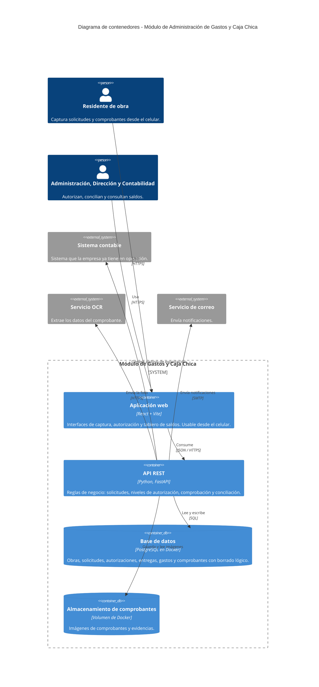

# Diagrama de Contenedores (C4 - Nivel 2)

> Abre la caja del **Módulo de Administración de Gastos y Caja Chica** del diagrama de contexto (`docs/CONTEXT.md`) y muestra las piezas que se ejecutan por separado, su tecnología y cómo se comunican. Es la propuesta para el prototipo.
>
> Issue: #47. Cada integrante completa su sección con un commit propio.

## Contenedores

### Aplicación web

**Responsable:** @jaaaaaaaaasiel

Construida con React y Vite, y pensada para usarse desde el celular en obra. Incluye las pantallas de docs/diseno: inicio del residente, captura de comprobante, bandeja de autorización, tablero de saldos y registro de solicitud. Se comunica con la API por HTTP intercambiando JSON; la dirección de la API se configura con una variable de entorno.

### API REST

**Responsable:** @juanpismata11

Construida en Python con FastAPI. Expone los endpoints de solicitudes (POST /api/solicitudes, GET /api/solicitudes, GET /api/solicitudes/{id} y DELETE /api/solicitudes/{id} con borrado lógico) y su documentación en Swagger en /docs. Aplica las reglas de negocio: clasificación obligatoria por obra, etapa y partida, asignación del nivel de autorización según el monto, y la prohibición de borrar o modificar gastos aprobados.

### Base de datos

**Responsable:** @bladeRunner08

PostgreSQL ejecutándose en un contenedor de Docker, levantado con `docker compose up -d` y con un volumen para no perder los datos. Guarda obras, solicitudes, autorizaciones, entregas, gastos y comprobantes. Ningún registro se borra físicamente: se usa borrado lógico con una fecha de eliminación, y las correcciones a gastos aprobados se hacen con registros de ajuste que referencian el original.

### Almacenamiento de comprobantes

**Responsable:** @PauAlba

Las fotografías de comprobantes y evidencias se guardan como archivos en un volumen de Docker, y en la base de datos solo se guarda la ruta del archivo asociada al gasto. Así la base de datos no crece con imágenes. Las fotos capturadas sin señal se guardarán primero en el celular y se enviarán al recuperar la conexión
(RNF02, iteración futura).

## Decisiones de arquitectura

**Responsable:** @casizzy

Se separó el sistema en aplicación web, API y base de datos para que cada parte se desarrolle y despliegue por separado y el equipo trabaje en paralelo. Se eligió FastAPI porque la API ya estaba construida en Python desde la Iteración 3, PostgreSQL en Docker para que todos tengan la misma base de datos sin instalarla, y una aplicación web que funcione desde el celular porque el residente captura en obra. El OCR, la exportación al sistema contable y el modo sin conexión quedan para iteraciones futuras.

