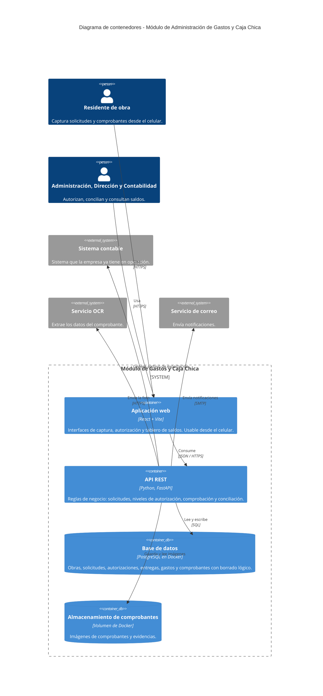

# Diagrama de Contenedores (C4 - Nivel 2)

> Abre la caja del **Módulo de Administración de Gastos y Caja Chica** del diagrama de contexto (`docs/CONTEXT.md`) y muestra las piezas que se ejecutan por separado, su tecnología y cómo se comunican. Es la propuesta para el prototipo.
>
> Issue: #47. Cada integrante completa su sección con un commit propio.

## Contenedores

### Aplicación web

**Responsable:** @jaaaaaaaaasiel

_Pendiente._ Tecnología elegida, qué interfaces incluye (`docs/diseno`) y cómo se comunica con la API.

### API REST

**Responsable:** @juanpismata11

_Pendiente._ Qué expone (endpoints principales, Swagger en `/docs`) y qué reglas de negocio aplica.

### Base de datos

**Responsable:** @bladeRunner08

_Pendiente._ Cómo se levanta el contenedor, qué tablas principales tiene y cómo se cumple el borrado lógico.

### Almacenamiento de comprobantes

**Responsable:** @PauAlba

_Pendiente._ Dónde se guardan las imágenes, cómo se relacionan con el gasto y qué pasa con las capturas sin conexión (RNF02).

## Decisiones de arquitectura

**Responsable:** @casizzy

_Pendiente._ Por qué se eligió esta separación y estas tecnologías, y qué queda para iteraciones futuras (OCR, exportación contable, modo sin conexión).
