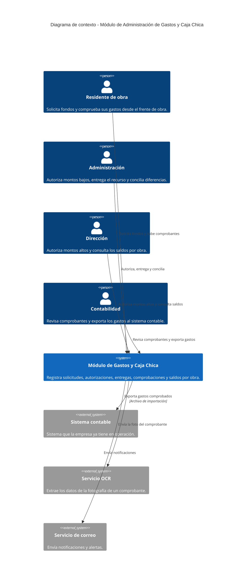

# Diagrama de Contexto (C4 - Nivel 1)

> Muestra el **Módulo de Administración de Gastos y Caja Chica** como una sola caja, quién lo usa y con qué sistemas externos se comunica. No muestra tecnologías; eso corresponde al diagrama de contenedores (`docs/CONTAINERS.md`).
>
> Issue: #46. Cada integrante completa su sección con un commit propio.

## Propósito y alcance del sistema

**Responsable:** @casizzy

El módulo controla el ciclo completo de la caja chica en las obras de la constructora: solicitud del fondo, autorización según el monto, entrega del recurso, comprobación del gasto y conciliación de diferencias. Reemplaza el control manual con notas y hojas de cálculo, y asocia cada gasto a una obra, etapa de construcción y partida. Queda fuera de su alcance la nómina, las compras mayores con orden de compra y la contabilidad general, que siguen en el sistema contable de la empresa.

## Personas

### Residente de obra

**Responsable:** @bladeRunner08

El residente usa el sistema desde el navegador de su celular en el frente de obra. Solicita fondos con el concepto, el monto, la urgencia y la evidencia de la necesidad, y después comprueba sus gastos tomando una foto del comprobante. Captura con prisa y a veces sin señal, por eso la interfaz debe requerir máximo 3 toques para registrar un ticket.

### Administración

**Responsable:** @juanpismata11

Administración recibe las solicitudes cuyo monto no supera los $5,000 y las aprueba o rechaza dejando comentarios. Después registra la entrega del recurso (efectivo, transferencia o tarjeta) con su referencia, y al final concilia lo entregado contra lo comprobado para registrar sobrantes, faltantes o reembolsos.

### Dirección

**Responsable:** @juanpismata11

Dirección autoriza las solicitudes que superan los $5,000; el sistema registra quién autorizó, cuándo y por qué monto. También consulta el tablero de saldos por obra para detectar a tiempo si el gasto se está saliendo del presupuesto.

### Contabilidad

**Responsable:** @jaaaaaaaaasiel

_Pendiente._ Qué revisa y qué obtiene del sistema (ver RF08 y RNF03).

## Sistemas externos

### Sistema contable

**Responsable:** @jaaaaaaaaasiel

_Pendiente._ Qué información recibe y en qué formato (ver RNF03).

### Servicio OCR

**Responsable:** @PauAlba

Servicio externo que recibe la fotografía del comprobante y devuelve el monto, el proveedor y la fecha para no capturarlos a mano. Si la lectura falla o es parcial, el residente completa los campos manualmente. Se integrará en una iteración futura (RF11).

### Servicio de correo

**Responsable:** @PauAlba

Envía las notificaciones del sistema: aviso al autorizador cuando llega una solicitud nueva, aviso al residente cuando su solicitud se aprueba, se rechaza o se bloquea por comprobaciones vencidas, y alertas a contabilidad sobre comprobaciones próximas a vencer o gastos repetidos.
