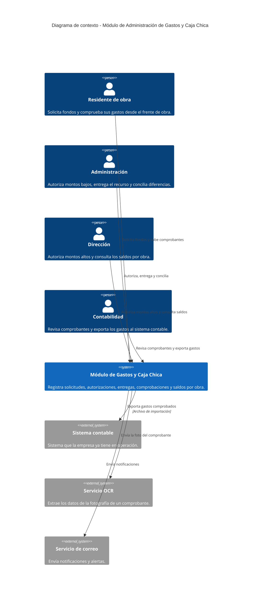

# Diagrama de Contexto (C4 - Nivel 1)

> Muestra el **Módulo de Administración de Gastos y Caja Chica** como una sola caja, quién lo usa y con qué sistemas externos se comunica. No muestra tecnologías; eso corresponde al diagrama de contenedores (`docs/CONTAINERS.md`).
>
> Issue: #46. Cada integrante completa su sección con un commit propio.

## Propósito y alcance del sistema

**Responsable:** @casizzy

_Pendiente._ Describir en un párrafo qué problema resuelve el módulo para la constructora y qué queda fuera de su alcance.

## Personas

### Residente de obra

**Responsable:** @bladeRunner08

_Pendiente._ Qué hace en el sistema, desde dónde lo usa y qué necesita (ver RF01, RF07, RNF01 y RNF02).

### Administración

**Responsable:** @juanpismata11

_Pendiente._ Qué autoriza, cuándo entrega el recurso y cómo concilia (ver RF03, RF05, RF06 y RF09).

### Dirección

**Responsable:** @juanpismata11

_Pendiente._ Qué montos autoriza y qué información consulta (ver RF03, RF05 y RF10).

### Contabilidad

**Responsable:** @jaaaaaaaaasiel

_Pendiente._ Qué revisa y qué obtiene del sistema (ver RF08 y RNF03).

## Sistemas externos

### Sistema contable

**Responsable:** @jaaaaaaaaasiel

_Pendiente._ Qué información recibe y en qué formato (ver RNF03).

### Servicio OCR

**Responsable:** @PauAlba

_Pendiente._ Qué datos extrae del comprobante y qué pasa si falla (ver RF11).

### Servicio de correo

**Responsable:** @PauAlba

_Pendiente._ Qué notificaciones y alertas se envían y a quién (ver HU01, RF04 y RF12).
