# Diagrama de flujo del sistema

> Derivado de `docs/REQUERIMIENTOS.md`. Cada nodo indica el requerimiento que lo origina (RF/RNF).
> Los carriles separan quién actúa: Residente, Autorizador, Contabilidad y Sistema.

```mermaid
flowchart TD
  classDef rf fill:#eff4ff,stroke:#2563eb,color:#111a30
  classDef decision fill:#fff8e1,stroke:#f2dc8a,color:#7a4a00
  classDef fin fill:#e3f6ee,stroke:#0f8a5f,color:#111a30
  classDef stop fill:#fde8e8,stroke:#c92a2a,color:#111a30
  classDef opc fill:#f4efff,stroke:#7c3aed,color:#111a30

  subgraph RES1["Residente: solicitud"]
    A(["Inicio"]) --> B["RF01 Registrar solicitud<br/>folio, obra, solicitante, etapa, concepto,<br/>monto, costo estimado, urgencia,<br/>partida y evidencia"]
  end

  subgraph SIS1["Sistema: validación"]
    C{"RF02 ¿Obra activa, etapa<br/>y partida válidas?"}
    D{"RF04 ¿Comprobaciones pendientes<br/>fuera del límite de antigüedad?"}
    E{"RF03 ¿Monto mayor<br/>al límite de Administración?"}
  end

  B --> C
  C -- "No" --> X1(["Solicitud no registrada"])
  C -- "Sí" --> D
  D -- "Sí" --> X2(["Bloqueada: comprobar antes<br/>de pedir un fondo nuevo"])
  D -- "No" --> E

  subgraph AUT["Autorizador: decisión"]
    F["RF03 Autoriza Administración"]
    G["RF03 Autoriza Dirección<br/>con firma digital"]
    H{"RF05 ¿Aprueba?"}
    I["RF05 Registra quién, cuándo,<br/>monto autorizado y comentarios"]
    J["RF05 Rechaza con comentario"]
  end

  E -- "No" --> F
  E -- "Sí" --> G
  F --> H
  G --> H
  H -- "No" --> J --> X3(["Solicitud rechazada"])
  H -- "Sí" --> I

  subgraph ENT["Entrega del recurso"]
    K["RF06 Registrar entrega<br/>forma, fecha, referencia<br/>y persona que entregó"]
  end

  I --> K

  subgraph RES2["Residente: captura en obra"]
    L["RNF01 Fotografiar comprobante<br/>máximo 3 toques"]
    M{"RNF02 ¿Hay conexión?"}
    N["RNF02 Guardar en el dispositivo<br/>y sincronizar en menos de 60 s"]
    O["RF11 Extraer datos de la foto<br/>captura manual mínima"]
    P["RF07 Completar comprobación<br/>tipo, monto, fecha, proveedor,<br/>concepto y horas si aplica"]
    Q["RF14 Clasificar gasto:<br/>cobrable al cliente o<br/>fondo de contingencia"]
  end

  K --> L --> M
  M -- "No" --> N --> O
  M -- "Sí" --> O
  O --> P --> Q

  subgraph CIE["Sistema: cierre de la comprobación"]
    R{"RF08 ¿Tiene comprobante<br/>con imagen legible?"}
    S{"RF08 ¿Es factura?"}
    T["Estatus: Comprobado"]
    U["Estatus: Revisión<br/>de Contabilidad"]
  end

  Q --> R
  R -- "No" --> X4(["No se puede cerrar<br/>como comprobado"])
  R -- "Sí" --> S
  S -- "Sí" --> T
  S -- "No: ticket o nota simple" --> U

  subgraph CON["Contabilidad"]
    V["Revisa el comprobante"]
  end

  U --> V --> T

  subgraph CONC["Sistema: conciliación y seguimiento"]
    W{"RF09 Monto comprobado<br/>contra monto entregado"}
    W1["Igual: sin diferencia"]
    W2["Sobrante: registrar devolución"]
    W3["Faltante o reembolso:<br/>registrar diferencia"]
    Y["RF10 Saldos por obra en tiempo real<br/>fondo, gastado, comprobado,<br/>pendiente y por reponer"]
    Z["RF14 Saldo del fondo<br/>de contingencia por obra"]
    AL["RF12 Alertas: comprobación por vencer,<br/>gastos repetidos y montos atípicos"]
    AM["RF13 Gasto real contra cotizado<br/>y avance de obra por partida"]
    AN["RNF03 Exportar información<br/>al sistema contable"]
  end

  T --> W
  W -- "Igual" --> W1
  W -- "Sobra" --> W2
  W -- "Falta" --> W3
  W1 --> Y
  W2 --> Y
  W3 --> Y
  Y --> Z
  Y --> AL
  Y --> AM
  Y --> AN --> FIN(["Fin del ciclo"])

  class B,F,G,I,J,K,L,N,P,Q,T,U,V,W1,W2,W3,Y,Z,AL,AM,AN rf
  class C,D,E,H,M,R,S,W decision
  class A,FIN fin
  class X1,X2,X3,X4 stop
  class O opc
```

## Leyenda

| Color | Significado |
| :--- | :--- |
| Azul | Paso o proceso del sistema |
| Amarillo | Decisión |
| Verde | Inicio y fin del ciclo |
| Rojo | Fin anticipado: el flujo se detiene |
| Violeta | Paso de prioridad baja (RF11, extracción automática) |

## Correspondencia con los requerimientos

| Requerimiento | Nodo del diagrama |
| :--- | :--- |
| RF01 | Registrar solicitud |
| RF02 | Validar obra, etapa y partida |
| RF03 | Nivel de autorización por monto |
| RF04 | Bloqueo por comprobaciones vencidas |
| RF05 | Aprobar o rechazar |
| RF06 | Registrar entrega |
| RF07 | Completar comprobación |
| RF08 | Cierre: Comprobado o Revisión de Contabilidad |
| RF09 | Conciliación del monto |
| RF10 | Saldos por obra |
| RF11 | Extracción de datos de la foto |
| RF12 | Alertas |
| RF13 | Gasto real contra avance de obra |
| RF14 | Clasificación del gasto y fondo de contingencia |
| RNF01 | Captura en máximo 3 toques |
| RNF02 | Guardado local sin conexión |
| RNF03 | Exportación al sistema contable |
